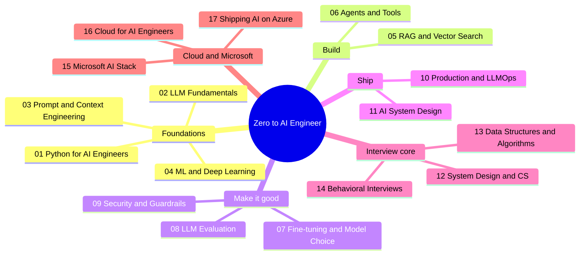

# Roadmap: Zero to AI Engineer in one map

Seventeen chapters in the order to study them: what each chapter covers, what you can do after it, and real interview questions that named companies have asked.

- **Video:** the 12-minute roadmap video on [youtube.com/@dev_with_data](https://www.youtube.com/@dev_with_data) walks this map chapter by chapter.
- **Interactive mind map:** open [`roadmap.html`](roadmap.html) in a browser (download it, or view it through GitHub Pages if enabled). Tap a chapter to jump to its card.

## The map

## Study order

| Stage | # | Chapter | Videos | After this chapter you can |
|---|---|---|---|---|
| Foundations | 01 | Python for AI Engineers | 26 | Write clean, tested Python and pass a Python coding round |
| Foundations | 02 | LLM Fundamentals | 18 | Explain how an LLM reads, predicts and writes, and what each token costs |
| Foundations | 03 | Prompt and Context Engineering | 10 | Write prompts and structured outputs that hold up, and control what enters the context |
| Foundations | 04 | ML and Deep Learning | 28 | Explain and code the core ML ideas, pick the right metric, and talk deep learning |
| Build | 05 | RAG and Vector Search | 26 | Build, debug and measure a RAG system from documents to cited answers |
| Build | 06 | Agents and Tools | 26 | Build agents that call tools safely, and defend the design |
| Make it good | 07 | Fine-tuning and Model Choice | 10 | Decide RAG or fine-tuning, and choose, size and serve a model you can defend |
| Make it good | 08 | LLM Evaluation | 11 | Prove that a change made things better, and gate releases on evidence |
| Make it good | 09 | Security and Guardrails | 11 | Find the attack paths in an AI app and close them in code |
| Ship | 10 | Production and LLMOps | 38 | Ship an AI service that is fast, affordable and observable |
| Ship | 11 | AI System Design | 17 | Run an AI design round from requirements to trade-offs |
| Interview core | 12 | System Design and CS | 50 | Design classic systems and answer CS fundamentals with confidence |
| Interview core | 13 | Data Structures and Algorithms | 36 | Solve interview problems with the right pattern, and talk while you code |
| Interview core | 14 | Behavioral Interviews | 29 | Tell true stories that show judgement, even under follow-up questions |
| Cloud and Microsoft | 15 | Microsoft AI Stack | 15 | Build and govern Copilot Studio and Power Platform solutions an enterprise trusts |
| Cloud and Microsoft | 16 | Cloud for AI Engineers | 14 | Map an AI system onto AWS, Azure or GCP, and defend each choice |
| Cloud and Microsoft | 17 | Shipping AI on Azure | 16 | Deploy a repeatable, secure AI solution on Azure from one repo |

## Chapter by chapter

### 01. Python for AI Engineers

**Topics:** Core language and classic traps; Functions, decorators, generators; OOP, errors and typing; Concurrency: threads, async, GIL; Testing and live coding.

**After this chapter you can:** write clean, tested Python and pass a Python coding round.

**Asked in real interviews:**

- **Deloitte:** Python coding round, in two Gen AI Engineer interviews ([R1](https://www.jointaro.com/interviews/companies/deloitte/experiences/gen-ai-engineer-india-december-1-2024-no-offer-negative-2c45121c), [R2](https://www.jointaro.com/interviews/companies/deloitte/experiences/gen-ai-engineer-bengaluru-karnataka-june-1-2025-no-offer-positive-5eb74f34/))
- **Infosys:** FastAPI: concurrency versus parallelism ([R15](https://www.glassdoor.com/Interview/Infosys-Interview-E7927-RVW104494652.htm))
- **Capgemini:** Python coding in a GenAI Engineer round ([R13](https://www.jointaro.com/interviews/companies/capgemini/experiences/genai-engineer-india-august-13-2025-accepted-offer-positive-ac5febe3))

### 02. LLM Fundamentals

**Topics:** Tokens, context and cost; Inside the transformer: attention; Decoding and sampling; Model behaviour and choice.

**After this chapter you can:** explain how an LLM reads, predicts and writes, and what each token costs.

**Asked in real interviews:**

- **Deloitte:** What is a transformer? ([R3](https://www.jointaro.com/interviews/companies/deloitte/experiences/genai-engineer-mumbai-maharashtra-august-1-2024-no-offer-positive-168852f5/))
- **Google:** Implement a multi-head attention class ([R18](https://www.glassdoor.co.uk/Interview/Google-Machine-Learning-Engineer-Interview-Questions-EI_IE9079.0,6_KO7,32.htm))
- **KPMG:** How does an LLM stop generating tokens? ([R8](https://clear.glassdoor.nl/Interview/KPMG-Generative-AI-Engineer-Interview-Questions-EI_IE2867.0,4_KO5,27.htm))
- **Fidelity:** Same prompt again: same answer? ([R16](https://www.jointaro.com/interviews/companies/fidelity-investments/experiences/aiml-engineer-west-lake-hills-texas-october-1-2025-no-offer-positive-012549fd/))

### 03. Prompt and Context Engineering

**Topics:** Prompt structure; Few-shot and chain of thought; Context engineering; Structured output.

**After this chapter you can:** write prompts and structured outputs that hold up, and control what enters the context.

**Asked in real interviews:**

- **Fidelity:** When should you use few-shot prompting? Context poisoning? ([R16](https://www.jointaro.com/interviews/companies/fidelity-investments/experiences/aiml-engineer-west-lake-hills-texas-october-1-2025-no-offer-positive-012549fd/))
- **Capgemini:** Prompting and LLMs, in a GenAI Engineer round ([R12](https://www.jointaro.com/interviews/companies/capgemini/experiences/gen-ai-engineer-hyderabad-march-29-2025-declined-offer-positive-ed8bdb1e))
- **Anthropic:** Rewrite a prompt until outputs match the target ([R23](https://www.glassdoor.com/Interview/Anthropic-Interview-E8109027-RVW81580967.htm))

### 04. ML and Deep Learning

**Topics:** Probability and statistics; Training mechanics; Metrics and calibration; Model families; Production ML; ML coding from scratch.

**After this chapter you can:** explain and code the core ML ideas, pick the right metric, and talk deep learning.

**Asked in real interviews:**

- **Accenture:** Explain the principles behind GANs ([R9](https://www.jointaro.com/interviews/companies/accenture/experiences/ai-engineer-chennai-tamil-nadu-september-15-2025-no-offer-neutral-b030d79d))
- **Capgemini:** ANN, RNN and LSTM ([R13](https://www.jointaro.com/interviews/companies/capgemini/experiences/genai-engineer-india-august-13-2025-accepted-offer-positive-ac5febe3))
- **IBM:** ML, deep learning and performance metrics ([R22](https://www.jointaro.com/interviews/companies/ibm/experiences/ai-engineer-bengaluru-february-1-2025-no-offer-positive-c881d31a))

### 05. RAG and Vector Search

**Topics:** Embeddings; Vector search; Chunk, search, rerank; Advanced RAG; Measuring retrieval; Document AI.

**After this chapter you can:** build, debug and measure a RAG system from documents to cited answers.

**Asked in real interviews:**

- **Deloitte:** What is RAG architecture? How do you search a very big RAG? ([R2](https://www.jointaro.com/interviews/companies/deloitte/experiences/gen-ai-engineer-bengaluru-karnataka-june-1-2025-no-offer-positive-5eb74f34/), [R3](https://www.jointaro.com/interviews/companies/deloitte/experiences/genai-engineer-mumbai-maharashtra-august-1-2024-no-offer-positive-168852f5/), [R5](https://static.glassdoor.fr/Interview/Deloitte-AI-Engineer-Interview-Questions-EI_IE2763.0,8_KO9,20_IP3.htm))
- **EY:** How do you prevent hallucination in RAG? ([R6](https://www.glassdoor.co.in/Interview/EY-Gen-AI-Engineer-Interview-Questions-EI_IE2784.0,2_KO3,18.htm), [R7](https://static-pc.glassdoor.fr/Interview/EY-AI-Engineer-Interview-Questions-EI_IE2784.0,2_KO3,14.htm))
- **KPMG:** Chunking and caching ([R8](https://clear.glassdoor.nl/Interview/KPMG-Generative-AI-Engineer-Interview-Questions-EI_IE2867.0,4_KO5,27.htm))
- **Fidelity:** How do you chunk a PDF? Why a vector database? ([R16](https://www.jointaro.com/interviews/companies/fidelity-investments/experiences/aiml-engineer-west-lake-hills-texas-october-1-2025-no-offer-positive-012549fd/))

### 06. Agents and Tools

**Topics:** Tool calling; The agent loop; Frameworks; MCP and A2A; Multi-agent systems; Design briefs and take-homes.

**After this chapter you can:** build agents that call tools safely, and defend the design.

**Asked in real interviews:**

- **Deloitte:** RAG versus agents. Shared memory between agents ([R2](https://www.jointaro.com/interviews/companies/deloitte/experiences/gen-ai-engineer-bengaluru-karnataka-june-1-2025-no-offer-positive-5eb74f34/))
- **Fidelity:** What is a ReAct agent? How do you stop cycles in LangGraph? ([R16](https://www.jointaro.com/interviews/companies/fidelity-investments/experiences/aiml-engineer-west-lake-hills-texas-october-1-2025-no-offer-positive-012549fd/))
- **EY:** Agentic workflows ([R7](https://static-pc.glassdoor.fr/Interview/EY-AI-Engineer-Interview-Questions-EI_IE2784.0,2_KO3,14.htm))

### 07. Fine-tuning and Model Choice

**Topics:** When to fine-tune; LoRA, QLoRA, DPO; Choosing and pricing models; KV cache and quantization; Serving with vLLM and Ollama.

**After this chapter you can:** decide RAG or fine-tuning, and choose, size and serve a model you can defend.

**Asked in real interviews:**

- **Mistral AI:** Explain LoRA fine-tuning. RAG or fine-tuning? ([R17](https://www.jointaro.com/interviews/companies/mistral-ai/experiences/applied-ai-engineer-luxemburg-july-1-2025-no-offer-negative-9129fa13))
- **Infosys:** RAG versus fine-tuning. Deploying a local LLM ([R15](https://www.glassdoor.com/Interview/Infosys-Interview-E7927-RVW104494652.htm))
- **Deloitte:** What is one-bit quantization? ([R1](https://www.jointaro.com/interviews/companies/deloitte/experiences/gen-ai-engineer-india-december-1-2024-no-offer-negative-2c45121c))
- **Capgemini:** Quantization and Ollama ([R11](https://www.jointaro.com/interviews/companies/capgemini/experiences/genai-engineer-hyderabad-february-1-2025-no-offer-positive-f633d4cd/))

### 08. LLM Evaluation

**Topics:** Golden sets and honest test data; Graders and metrics; RAG and agent metrics; LLM as judge; Hallucination.

**After this chapter you can:** prove that a change made things better, and gate releases on evidence.

**Asked in real interviews:**

- **Deloitte:** Metrics: BLEU and ROUGE ([R4](https://www.glassdoor.co.in/Interview/Deloitte-Gen-AI-Engineer-Interview-Questions-EI_IE2763.0,8_KO9,24.htm))
- **EY:** How do you prevent hallucination? ([R6](https://www.glassdoor.co.in/Interview/EY-Gen-AI-Engineer-Interview-Questions-EI_IE2784.0,2_KO3,18.htm))
- **Fidelity:** How do you evaluate your prompts and answers? ([R16](https://www.jointaro.com/interviews/companies/fidelity-investments/experiences/aiml-engineer-west-lake-hills-texas-october-1-2025-no-offer-positive-012549fd/))

### 09. Security and Guardrails

**Topics:** Prompt injection and leaks; Architectural defences; Guardrails in production; Privacy and compliance.

**After this chapter you can:** find the attack paths in an AI app and close them in code.

**Asked in real interviews:**

- **Fidelity:** Context poisoning in chatbots ([R16](https://www.jointaro.com/interviews/companies/fidelity-investments/experiences/aiml-engineer-west-lake-hills-texas-october-1-2025-no-offer-positive-012549fd/))
- Thin evidence: no first-hand report read for this map named prompt injection directly.

### 10. Production and LLMOps

**Topics:** Cost and latency; The FastAPI backend; Deployment; Observability; Agents in production; API security.

**After this chapter you can:** ship an AI service that is fast, affordable and observable.

**Asked in real interviews:**

- **Fidelity:** Validate auth tokens in FastAPI with dependency injection ([R16](https://www.jointaro.com/interviews/companies/fidelity-investments/experiences/aiml-engineer-west-lake-hills-texas-october-1-2025-no-offer-positive-012549fd/))
- **Infosys:** Docker CMD versus ENTRYPOINT. Failed Celery tasks ([R15](https://www.glassdoor.com/Interview/Infosys-Interview-E7927-RVW104494652.htm))
- **Capgemini:** A candidate rejected for no deployment experience ([R11](https://www.jointaro.com/interviews/companies/capgemini/experiences/genai-engineer-hyderabad-february-1-2025-no-offer-positive-f633d4cd/))

### 11. AI System Design

**Topics:** The answer shape; Docs chatbot at scale; Support ticket agent; Enterprise AI platform; Customer scenario round.

**After this chapter you can:** run an AI design round from requirements to trade-offs.

**Asked in real interviews:**

- **Deloitte:** Scenario: how would you design an agent? ([R2](https://www.jointaro.com/interviews/companies/deloitte/experiences/gen-ai-engineer-bengaluru-karnataka-june-1-2025-no-offer-positive-5eb74f34/))
- **Fidelity:** Architecture for a multi-agent system ([R16](https://www.jointaro.com/interviews/companies/fidelity-investments/experiences/aiml-engineer-west-lake-hills-texas-october-1-2025-no-offer-positive-012549fd/))
- **Accenture:** Which approach when you build a chatbot? ([R10](https://static.glassdoor.ch/Interview/Accenture-AI-Engineer-Interview-Questions-EI_IE4138.0,9_KO10,21_IP2.htm))

### 12. System Design and CS

**Topics:** Fundamentals and building blocks; Classic design problems; Operating systems and networking; Databases and SQL; Web security basics.

**After this chapter you can:** design classic systems and answer CS fundamentals with confidence.

**Asked in real interviews:**

- **Deloitte:** Design an e-commerce platform for one million daily users ([R21](https://www.jointaro.com/interviews/companies/deloitte/experiences/senior-cloud-engineer-gurgaon-haryana-march-1-2025-accepted-offer-positive-861ce9ab/))
- **Infosys:** Database indexing ([R15](https://www.glassdoor.com/Interview/Infosys-Interview-E7927-RVW104494652.htm))
- **IBM:** Two SQL queries in the online test ([R22](https://www.jointaro.com/interviews/companies/ibm/experiences/ai-engineer-bengaluru-february-1-2025-no-offer-positive-c881d31a))

### 13. Data Structures and Algorithms

**Topics:** How the round works; Core patterns; Applied coding; Machine coding.

**After this chapter you can:** solve interview problems with the right pattern, and talk while you code.

**Asked in real interviews:**

- **Amazon:** Cycle in a graph. A design like an LRU cache ([R20](https://www.jointaro.com/interviews/companies/amazon/experiences/sde2-backend-india-may-13-2025-declined-offer-positive-28ef8488/))
- **Microsoft:** Call times: when was no phone busy? ([R19](https://clear.glassdoor.nl/Interview/Microsoft-AI-Software-Engineer-Interview-Questions-EI_IE1651.0,9_KO10,30.htm))
- **IBM:** Two DSA questions ([R22](https://www.jointaro.com/interviews/companies/ibm/experiences/ai-engineer-bengaluru-february-1-2025-no-offer-positive-c881d31a))

### 14. Behavioral Interviews

**Topics:** Positioning; Story craft; Walk me through your project; Failure, and disagree and commit; Company frameworks.

**After this chapter you can:** tell true stories that show judgement, even under follow-up questions.

**Asked in real interviews:**

- **Amazon:** Leadership principle questions in every round ([R20](https://www.jointaro.com/interviews/companies/amazon/experiences/sde2-backend-india-may-13-2025-declined-offer-positive-28ef8488/))
- **Deloitte:** A deployment fails in a client demo. What do you do? ([R21](https://www.jointaro.com/interviews/companies/deloitte/experiences/senior-cloud-engineer-gurgaon-haryana-march-1-2025-accepted-offer-positive-861ce9ab/))
- **Accenture:** Why switch after two years? ([R10](https://static.glassdoor.ch/Interview/Accenture-AI-Engineer-Interview-Questions-EI_IE4138.0,9_KO10,21_IP2.htm))

### 15. Microsoft AI Stack

**Topics:** Tenant governance; ALM and Dataverse; Power Apps and Power Automate; Copilot Studio; Agent identity; Microsoft Foundry.

**After this chapter you can:** build and govern Copilot Studio and Power Platform solutions an enterprise trusts.

**Asked in real interviews:**

- **Capgemini:** How can a flow keep running after an error? ([R14](https://www.jointaro.com/interviews/companies/capgemini/experiences/power-platform-developer-united-kingdom-april-22-2025-accepted-offer-positive-799198a5))

### 16. Cloud for AI Engineers

**Topics:** Identity; Compute and storage; Networking; State and messaging; Operations and cost; AI services on each cloud.

**After this chapter you can:** map an AI system onto AWS, Azure or GCP, and defend each choice.

**Asked in real interviews:**

- **Deloitte:** NACLs versus security groups. Spot, reserved or on-demand? ([R21](https://www.jointaro.com/interviews/companies/deloitte/experiences/senior-cloud-engineer-gurgaon-haryana-march-1-2025-accepted-offer-positive-861ce9ab/))
- **Amazon:** A five-minute discussion on an AWS service ([R20](https://www.jointaro.com/interviews/companies/amazon/experiences/sde2-backend-india-may-13-2025-declined-offer-positive-28ef8488/))

### 17. Shipping AI on Azure

**Topics:** Solution templates; Bicep and Verified Modules; Identity and RBAC; azd deployment; Agent Framework and Foundry; Repo standards and open source.

**After this chapter you can:** deploy a repeatable, secure AI solution on Azure from one repo.

**Asked in real interviews:**

- **Deloitte:** Feedback: more depth on Terraform modules. GDPR in cloud deployments ([R21](https://www.jointaro.com/interviews/companies/deloitte/experiences/senior-cloud-engineer-gurgaon-haryana-march-1-2025-accepted-offer-positive-861ce9ab/))

## What came up most

How many of the 23 first-hand interview reports mention each topic. A small sample: read these as signals, not rankings.

| Topic | Reports |
|---|---|
| RAG | 12 of 23 |
| Python | 6 of 23 |
| Transformers and LLM internals | 6 of 23 |
| Classic ML and deep learning | 6 of 23 |
| Fine-tuning, quantization, local models | 5 of 23 |
| Agents | 4 of 23 |
| Prompting | 4 of 23 |
| Evaluation | 4 of 23 |
| Deployment and backend | 3 of 23 |
| DSA and SQL coding | 3 of 23 |
| Behavioural | 3 of 23 |

## How the company tags were chosen

A tag appears only where a first-hand candidate report (Glassdoor or Jointaro) names that company and that topic. Aggregator question banks were read but not used as evidence. Nobody publishes how often a question is asked, so no counts are invented: every number here is out of these 23 reports. Research checked 14 Nov 2026.

| Ref | Company | Report |
|---|---|---|
| R1 | Deloitte | [Gen AI Engineer, India, Dec 2024](https://www.jointaro.com/interviews/companies/deloitte/experiences/gen-ai-engineer-india-december-1-2024-no-offer-negative-2c45121c) |
| R2 | Deloitte | [Gen AI Engineer, Bengaluru, Jun 2025](https://www.jointaro.com/interviews/companies/deloitte/experiences/gen-ai-engineer-bengaluru-karnataka-june-1-2025-no-offer-positive-5eb74f34/) |
| R3 | Deloitte | [GenAI Engineer, Mumbai, Aug 2024](https://www.jointaro.com/interviews/companies/deloitte/experiences/genai-engineer-mumbai-maharashtra-august-1-2024-no-offer-positive-168852f5/) |
| R4 | Deloitte | [Gen AI Engineer, Glassdoor](https://www.glassdoor.co.in/Interview/Deloitte-Gen-AI-Engineer-Interview-Questions-EI_IE2763.0,8_KO9,24.htm) |
| R5 | Deloitte | [AI Engineer, Cairo, Oct 2023](https://static.glassdoor.fr/Interview/Deloitte-AI-Engineer-Interview-Questions-EI_IE2763.0,8_KO9,20_IP3.htm) |
| R6 | EY | [Gen AI Engineer, Glassdoor](https://www.glassdoor.co.in/Interview/EY-Gen-AI-Engineer-Interview-Questions-EI_IE2784.0,2_KO3,18.htm) |
| R7 | EY | [AI Engineer, Amsterdam, Apr 2026](https://static-pc.glassdoor.fr/Interview/EY-AI-Engineer-Interview-Questions-EI_IE2784.0,2_KO3,14.htm) |
| R8 | KPMG | [Generative AI Engineer, Glassdoor](https://clear.glassdoor.nl/Interview/KPMG-Generative-AI-Engineer-Interview-Questions-EI_IE2867.0,4_KO5,27.htm) |
| R9 | Accenture | [AI Engineer, Chennai, Sep 2025](https://www.jointaro.com/interviews/companies/accenture/experiences/ai-engineer-chennai-tamil-nadu-september-15-2025-no-offer-neutral-b030d79d) |
| R10 | Accenture | [AI Engineer, Glassdoor](https://static.glassdoor.ch/Interview/Accenture-AI-Engineer-Interview-Questions-EI_IE4138.0,9_KO10,21_IP2.htm) |
| R11 | Capgemini | [GenAI Engineer, Hyderabad, Feb 2025](https://www.jointaro.com/interviews/companies/capgemini/experiences/genai-engineer-hyderabad-february-1-2025-no-offer-positive-f633d4cd/) |
| R12 | Capgemini | [Gen AI Engineer, Hyderabad, Mar 2025](https://www.jointaro.com/interviews/companies/capgemini/experiences/gen-ai-engineer-hyderabad-march-29-2025-declined-offer-positive-ed8bdb1e) |
| R13 | Capgemini | [GenAI Engineer, India, Aug 2025](https://www.jointaro.com/interviews/companies/capgemini/experiences/genai-engineer-india-august-13-2025-accepted-offer-positive-ac5febe3) |
| R14 | Capgemini | [Power Platform Developer, UK, Apr 2025](https://www.jointaro.com/interviews/companies/capgemini/experiences/power-platform-developer-united-kingdom-april-22-2025-accepted-offer-positive-799198a5) |
| R15 | Infosys | [Python Gen AI Engineer, Jun 2026](https://www.glassdoor.com/Interview/Infosys-Interview-E7927-RVW104494652.htm) |
| R16 | Fidelity | [AI/ML Engineer, Texas, Oct 2025](https://www.jointaro.com/interviews/companies/fidelity-investments/experiences/aiml-engineer-west-lake-hills-texas-october-1-2025-no-offer-positive-012549fd/) |
| R17 | Mistral AI | [Applied AI Engineer, Luxembourg, Jul 2025](https://www.jointaro.com/interviews/companies/mistral-ai/experiences/applied-ai-engineer-luxemburg-july-1-2025-no-offer-negative-9129fa13) |
| R18 | Google | [Machine Learning Engineer, Aug 2025](https://www.glassdoor.co.uk/Interview/Google-Machine-Learning-Engineer-Interview-Questions-EI_IE9079.0,6_KO7,32.htm) |
| R19 | Microsoft | [AI Software Engineer, Glassdoor](https://clear.glassdoor.nl/Interview/Microsoft-AI-Software-Engineer-Interview-Questions-EI_IE1651.0,9_KO10,30.htm) |
| R20 | Amazon | [SDE2 Backend, India, May 2025](https://www.jointaro.com/interviews/companies/amazon/experiences/sde2-backend-india-may-13-2025-declined-offer-positive-28ef8488/) |
| R21 | Deloitte | [Senior Cloud Engineer, Gurgaon, Mar 2025](https://www.jointaro.com/interviews/companies/deloitte/experiences/senior-cloud-engineer-gurgaon-haryana-march-1-2025-accepted-offer-positive-861ce9ab/) |
| R22 | IBM | [AI Engineer, Bengaluru, Feb 2025](https://www.jointaro.com/interviews/companies/ibm/experiences/ai-engineer-bengaluru-february-1-2025-no-offer-positive-c881d31a) |
| R23 | Anthropic | [AI Prompt Engineer, San Francisco, Sep 2023](https://www.glassdoor.com/Interview/Anthropic-Interview-E8109027-RVW81580967.htm) |
