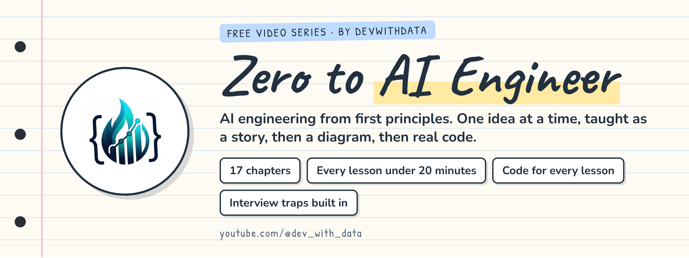
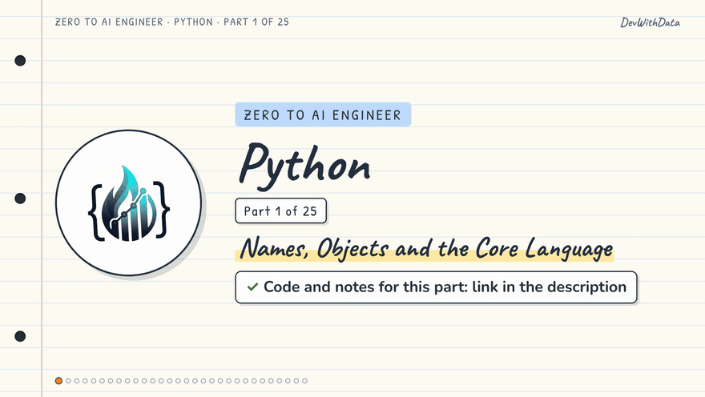
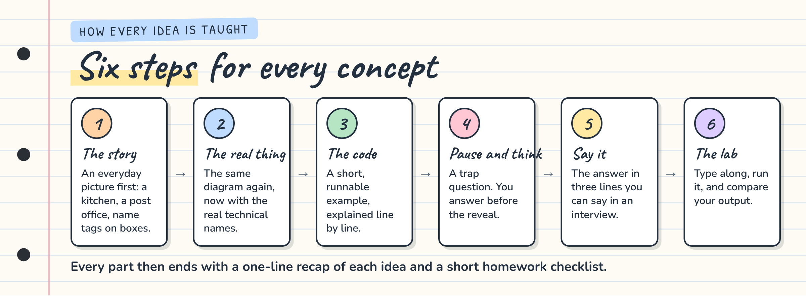
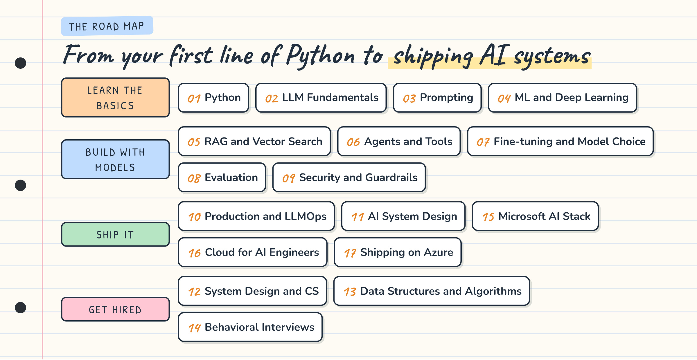

<p align="center">
  
</p>

# Zero to AI Engineer

**A free, step-by-step video series that takes you from your first line of Python to building and shipping AI systems.** It covers Python, LLM fundamentals, prompt engineering, RAG, AI agents, evaluation, production and system design, with the interview questions that go with each topic.

This repo is the companion to the videos. For every part you get the notes, the code from the slides, a follow-along lab, the pause-and-think questions and a click-through lesson page.

**Watch the series:** [youtube.com/@dev_with_data](https://www.youtube.com/@dev_with_data)

## See a lesson in 20 seconds

<p align="center">
  
</p>

These are real frames from Part 1. In the video, the narrator explains one step, the slide moves to the next step, and you follow along.

## Why this series exists

Most AI tutorials show you what to type. Real projects and interviews ask something harder: why does it work, and where does it break?

This series is built for that second question.

- **Fundamentals first.** You learn how names bind to objects before you learn agents. Each chapter stands on the one before it.
- **Every idea, taught three ways.** First as an everyday story, then as a diagram with the real names, then as code you can run.
- **The traps are part of the lesson.** Each idea comes with the mistake people make and the question an interviewer asks next.
- **Short lessons.** Every part is under 20 minutes and covers four to six ideas, so one part a day is realistic.
- **Free to follow.** The videos, the code and the notes are free. You do not need a paid API key. See [FREE_TOOLS.md](FREE_TOOLS.md).

## How every idea is taught

<p align="center">
  
</p>

| Step | What happens | Why it is there |
|---|---|---|
| The story | An everyday picture: a kitchen, a post office, name tags on boxes | A picture you can remember |
| The real thing | The same diagram with the real technical names | The picture becomes the concept |
| The code | A short example, explained line by line | You see it work |
| Pause and think | A trap question with three options | You commit to an answer before the reveal |
| Say it | The answer in three lines | You have the words ready for an interview |
| The lab | You type along and compare your output | Your hands learn it too |

Each part ends with a one-line recap of every idea and a short homework checklist.

## What is in this repo

```text
zero-to-ai-engineer/
├── README.md            you are here
├── SETUP.md             Python setup, API keys, and the same call on OpenAI or Gemini
├── FREE_TOOLS.md        free websites to try the ideas without an API key
├── 01-python/           one folder per chapter
│   ├── README.md        the chapter's parts
│   └── part-01-.../     one folder per video
│       ├── README.md    notes, takeaways, questions with answers, homework
│       ├── code/        every code slide as a file you can run, plus the lab
│       └── lesson.html  the whole lesson as a click-through page
└── ...
```

Every code file was run when its folder was built. If a file needs a package, a key or your own input files, a note at the top says so.

## The road map

<p align="center">
  
</p>

The series is published chapter by chapter, starting with Python. A chapter's folder appears here when its videos go live.

<!--CHAPTERS-->
| # | Chapter | Planned parts | In this repo |
|---|---|---|---|
| 01 | [Python](01-python/) | 25 | 4 parts |
| 02 | LLM Fundamentals | 18 | coming |
| 03 | Prompting and Context Engineering | 10 | coming |
| 04 | Machine Learning and Deep Learning | 28 | coming |
| 05 | RAG and Vector Search | 26 | coming |
| 06 | Agents and Tools | 26 | coming |
| 07 | Fine-tuning and Model Choice | 10 | coming |
| 08 | Evaluation | 11 | coming |
| 09 | Security and Guardrails | 11 | coming |
| 10 | Production and LLMOps | 38 | coming |
| 11 | AI System Design | 17 | coming |
| 12 | System Design and CS Fundamentals | 50 | coming |
| 13 | Data Structures and Algorithms | 36 | coming |
| 14 | Behavioral Interviews | 29 | coming |
| 15 | Microsoft AI Stack | 15 | coming |
| 16 | Cloud for AI Engineers | 14 | coming |
| 17 | Shipping on Azure | 16 | coming |
<!--/CHAPTERS-->

## Start here

1. Watch a part on [YouTube](https://www.youtube.com/@dev_with_data).
2. Open that part's folder in this repo and read the notes.
3. Run the files in `code/`, then type the lab yourself.
4. Answer the pause-and-think questions before you open the answers.
5. Do the homework checklist before the next part.

```bash
git clone https://github.com/shashikantdev3/zero-to-ai-engineer.git
cd zero-to-ai-engineer/01-python
```

You need Python 3.12 or newer. Setup steps are in [SETUP.md](SETUP.md).

## No API key? No problem

Labs never call a paid API, so you can type every one of them for free. For the lessons on tokens, temperature and prompts, [FREE_TOOLS.md](FREE_TOOLS.md) lists free websites where you can try the same ideas in your browser.

When a lesson does call a model, the code uses the Anthropic SDK and reads the key from an environment variable. [SETUP.md](SETUP.md) shows the same call for OpenAI and Gemini.

## Who this is for

- Students and freshers who want a clear path into AI engineering.
- Developers, testers, analysts and support engineers moving into AI roles.
- Anyone preparing for AI engineer interviews who wants the reasons, not just the answers.

You need basic computer skills and patience. You do not need a maths degree or earlier AI experience.

## Questions

**Is it really free?** Yes. The videos, this repo and the lesson pages are free.

**How long does it take?** Each part is under 20 minutes. At one part a day, the Python chapter takes about 25 days.

**Do I have to start with Python?** If you already write Python daily, skim Chapter 1 for the traps and start at Chapter 2.

## Follow along

- Subscribe on YouTube: [youtube.com/@dev_with_data](https://www.youtube.com/@dev_with_data)
- Star this repo so you can find it again, and watch it to see new chapters arrive.
- Found a mistake? Open an issue with the part number and the file name.

Made by **DevWithData**.
